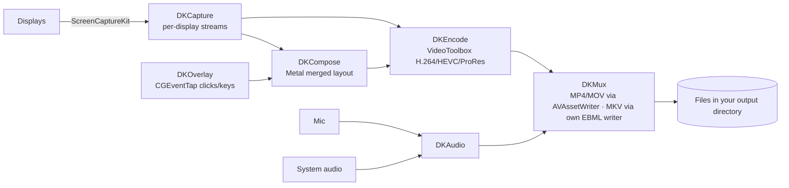

<div align="center">


# Disynk

**Multi-display recording, screenshots and on-device OCR for macOS.**

[](https://github.com/Rhinocros/Disynk/actions/workflows/release.yml)
[](https://github.com/Rhinocros/Disynk/releases/latest)
[](#system-requirements)
[](#system-requirements)
[](#build-from-source)
[](LICENSE)

**English** · [简体中文](README.zh-CN.md)

</div>

---

## What it is

Disynk is a native macOS app for people whose work spans more than one screen. It captures several
displays at once and, in the same pass, writes a **merged** composition of the whole desktop layout —
so you get both the individual tracks and one video that shows how they related. Everything stays on
your machine: pixels, microphone audio and text recognition are all processed locally. No account is
needed to record, nothing is uploaded, and there is no analytics SDK in the binary.

The app is menu-bar resident; a global shortcut starts and stops recording without bringing the app
forward. The main window is organised as 录制 / 截图·OCR / 快捷键 / 虚拟屏 / 权限 / 关于
(record, capture, shortcuts, virtual displays, license, permissions, about).

## Features

| Area | What you get |
| --- | --- |
| **Recording** | Single display, all displays concurrently, and a merged composition of the desktop layout. Frame rates and per-display selection are configurable. |
| **Encoding** | H.264, HEVC (H.265), ProRes 422 through VideoToolbox. Bitrate is estimated from pixel count, fps and codec (HEVC ≈ 0.65× the H.264 rate); ProRes runs on the CPU path and the UI warns when you record several displays with it. |
| **Containers** | MP4 / MOV via `AVAssetWriter`; MKV via an in-house EBML writer (`DKMux`), so MKV needs no external muxer. |
| **Audio** | System audio and microphone mixed to AAC in the same pass. |
| **Screenshots** | Full-screen, single window and free region capture; scrolling long-screenshot stitching; export of OCR results as TXT or Markdown. |
| **OCR** | Offline text recognition via Apple Vision with `zh-Hans`, `zh-Hant`, `en-US`. No online recognition service is ever called. |
| **GIF / WebM** | Short-loop GIF export, and WebM VP8/VP9 software encoding when the optional libvpx build is wired in. |
| **Overlays** | Click highlights and keystroke captions rendered into the recording, driven by a `CGEventTap`. |
| **Virtual displays** | Extra headless displays through the private `CGVirtualDisplay` API (Objective-C bridge in `Sources/DVKObjC`). |
| **Camera** | Webcam picture-in-picture composited into the capture. |
| **Menu bar** | Resident status item, ⌘-click menu, global shortcuts. Default record toggle is `⌘⇧R`; every action is rebindable in the *Shortcuts* tab. |
## How a recording is put together



Modules are one-directional and each is independently testable — see
[docs/ARCHITECTURE.md](docs/ARCHITECTURE.md) for the dependency table and the reasoning behind the
engineering choices.

## System requirements

- **macOS 15 (Sequoia) or later** — the deployment target is `x-apple-macos15.0`. macOS 15 is also the
  last release that supports Intel Macs, so the Intel ceiling and our floor coincide.
- **Universal binaries** — released DMGs carry both `arm64` and `x86_64` slices, built by CI on an
  Apple Silicon runner (the `x86_64` slice is cross-compiled against the macOS SDK).
- **On Intel**, the machine must be a model that can run Sequoia — see
  [Apple's compatibility list](https://support.apple.com/en-us/120282).
- Permissions: Screen Recording (capture), Microphone (voice-over), Accessibility (click/keystroke
  overlay and global shortcuts), Camera (picture-in-picture), Apple Events (window arrangement; only
  requested by hardened-runtime builds). A missing permission disables only the feature that needs it,
  it never degrades the other captures.

> **Status of Intel support:** the `x86_64` slice is built and verified to be present in every
> released binary, but it has not been run on Intel hardware by the author. Hardware encoder
> availability (HEVC/ProRes), multi-display ScreenCaptureKit throughput and the private virtual-display
> API all behave differently on Intel Macs, so treat Intel use as best-effort and report anything that
> breaks.

## Install and first run

1. Download `Disynk-<version>.dmg` from the
   [latest release](https://github.com/Rhinocros/Disynk/releases/latest) and drag `Disynk.app` into
   *Applications*.
2. Releases are **ad-hoc signed and not notarised**, so Gatekeeper blocks the first launch:
   ```sh
   xattr -cr /Applications/Disynk.app
   ```
   or open *System Settings → Privacy & Security* and click **Allow Anyway**.
3. Grant Screen Recording (and Microphone / Accessibility if you want those) from the app's *Permissions*
   tab — it opens the right privacy pane for you.
4. Press `⌘⇧R` to record.

Because an ad-hoc signature's code hash changes on every rebuild, macOS sees each update as a new app:
**Screen Recording has to be re-granted after updating.** The *Permissions* tab walks you through it
(`tccutil` hint plus a direct link to the pane). A Developer ID + notarized build (which keeps grants
across updates) is produced by the same script via environment variables — see
[docs/ARCHITECTURE.md](docs/ARCHITECTURE.md) §5.

## Using it

**Recording.** Pick displays, choose codec/container, set fps and bitrate. Recording several displays
gives you per-display files; enabling merged output adds one composed video of the whole layout.
ProRes on multiple simultaneous displays is a CPU-bound path — the app warns you rather than silently
dropping frames.

**Capture and OCR.** Region / window / full-screen shots go to the output directory. Scrolling capture
stitches a long image. OCR runs on-device and can be exported as TXT or Markdown.

**Overlays.** Turn on click/keystroke overlays and they are composited into the recorded frames, so
what you capture is what you get — no post-pass burn-in step to run afterwards.

**Virtual displays.** Create headless displays to lay out more canvas than you physically have — useful
for recording a big timeline, or for isolating an app's window. This uses an undocumented CoreGraphics
interface; see *Known limitations*.

## Build from source

The project has **zero third-party Swift dependencies** — only Apple system frameworks, plus an
optional libvpx dylib for WebM.

```sh
zsh Scripts/build.sh       # compile every module → .build/<arch>/Disynk
zsh Scripts/test.sh        # build + run the assertion harness in Tests/DKTests
zsh Scripts/package.sh     # build → assemble .app → sign → .build/dist/Disynk-<version>.dmg
zsh Scripts/build_libvpx.sh  # fetch libvpx v1.15.2 and build the WebM dylib
```

Build knobs (all defaults keep a local single-arch, no-libvpx loop fast):

| Variable | Default | Meaning |
| --- | --- | --- |
| `DISYNK_ARCHS` | host arch | Space-separated list to lipo into one binary, e.g. `arm64 x86_64`. |
| `DISYNK_MIN_MACOS` | `15.0` | Deployment target for the `-target` triple. |
| `DISYNK_WITH_LIBVPX` | auto when dylib exists | `1` wires WebM encoding in, `0` skips it. |
| `DISYNK_VERSION` | `Resources/Info.plist` | Version stamped into the bundle by `package.sh`. |
| `LIBVPX_VERSION` | `1.15.2` | Upstream tag that `build_libvpx.sh` pins. |

Architecture, deployment target and the toolchain quirk workaround live in
[`Scripts/toolchain.zsh`](Scripts/toolchain.zsh) — one definition, sourced by every script.

**Optional WebM.** `package.sh` enables libvpx wiring automatically when
`Scripts/vendor/libvpx/lib/libvpx.11.dylib` exists (the dylib is git-ignored). Without it
`WebMExporter.codecFactory` stays `nil` and choosing WebM output fails at runtime; nothing else is
affected. CI builds libvpx from upstream source, verifies each architecture slice exports everything
the hand-written shim declares, rewrites the install name to `@rpath/libvpx.11.dylib`, and copies it
into `Disynk.app/Contents/Frameworks`.

**Tests.** `Tests/DKTests/main.swift` is a plain assertion runner (no XCTest — it is an executable
target) covering encode × mux matrices, MKV audio, WebM
containers, Metal composition and merge, settings round-trips, screenshot/OCR export, pixel math,
scroll stitching, overlay combinations, capture fps clamping and permission re-authorization.
`Scripts/test.sh` additionally re-opens the produced files with an external decoder (PyAV/ffmpeg, via
`Scripts/verify_media.py`) so our own container writer is checked against a third-party reader.

## Repository layout

```
Sources/
  DKCore/ DKSettings/                shared types, geometry, settings
  DKEncode/ DKMux/                   VideoToolbox encoding, MP4/MOV/MKV output
  DKCapture/ DKCompose/ DKAudio/     ScreenCaptureKit capture, Metal composition, audio
  DKShot/ DKOverlay/ DKExport/       screenshots + OCR, event overlays, GIF/WebM export
  DKVirtualDisplay/ DVKObjC/         private CGVirtualDisplay bridge
  DisynkApp/                         AppKit/SwiftUI shell, menu bar, main window
Resources/                           Info.plist (version source of truth), icons, entitlements
Scripts/                             toolchain.zsh, build, test, package, make_icon,
                                   build_libvpx, verify_media, publish-github, vendor/libvpx
Tests/                               assertion harness (XCTest targets are placeholders)
docs/ARCHITECTURE.md                 module topology, tech-stack table, engineering decisions
.github/workflows/release.yml        tag-triggered build and publish
logo/                                app icon, menu bar icon, vector assets
```

## Known limitations

- **Virtual displays** rely on `CGVirtualDisplay`, an undocumented API. A macOS major update can break
  it; the in-app notice disclaims loss of recordings for that reason.
- **Ad-hoc signing** means re-granting Screen Recording after every update, and Gatekeeper friction on
  first launch. Notarized builds require a Developer ID identity, available to the maintainer only.
- **Intel builds ship but are untested on Intel hardware** (see System requirements).
- **No camera/microphone or screen content ever leaves the machine** — but that also means there is no
  cloud sync of presets or recordings.
- The recording pipeline assumes a real GPU/WindowServer session. Headless/remote-desktop sessions
  without a display can produce no frames at all — connect a display or use a virtual display.

## Privacy

Screen content, microphone audio, camera frames and OCR all stay on your machine. Text recognition
uses Apple Vision; no online recognition service is called. Disynk collects no usage data, shows no
ads, and bundles no analytics SDK, and it makes no network connections at all — there is no
activation check, no phone-home and no update ping. Diagnostics go to the standard macOS system
log and contain feature status and error text, never pixel content.

## Licensing

Disynk is free software: the source in this repository is licensed under the **GNU General Public
License version 3 or any later version** (GPL-3.0-or-later); the verbatim text is in
[LICENSE](LICENSE).

On top of it, [ADDITIONAL-TERMS.md](ADDITIONAL-TERMS.md) appends the terms permitted by GPL-3.0
**§7(b) and §7(c)**:

- Redistributing Disynk, modified or not, must keep the project source location
  <https://github.com/Rhinocros/Disynk>, a statement of origin, and the full text of `LICENSE`,
  `ADDITIONAL-TERMS.md` and `THIRD-PARTY-NOTICES.md`.
- A derivative build must keep **at least one clickable link** to that address in its user interface
  (Disynk puts it in the *About* tab); it may be restyled or relocated but not removed or turned
  into dead text.
- Anything you convey must stay open: the whole derivative is GPL-3.0-or-later with the complete
  corresponding source; closed-source distribution is not permitted.

Releases before 2026-10 carried a proprietary notice tied to license activation. That mechanism —
activation codes, hardware fingerprint binding, feature gating — has been removed from the tree, and
the old proprietary terms do not apply to this source or its derivatives.

Third-party components are listed in [THIRD-PARTY-NOTICES.md](THIRD-PARTY-NOTICES.md) — in particular
libvpx (BSD-3-Clause), whose license text CI attaches to each release.

## Releases and CI

Pushing a `vX.Y.Z` tag triggers [`.github/workflows/release.yml`](.github/workflows/release.yml):
it builds libvpx, compiles every module for `arm64` **and** `x86_64`, lipos them into one binary,
assembles and ad-hoc-signs the `.app`, creates the DMG, then publishes it to GitHub Releases
(plus a `workflow_dispatch` button for manual runs). Moving an existing tag re-runs the build and
replaces the asset of the same name.

The public repository carries release snapshots only — see
[`Scripts/publish-github.sh`](Scripts/publish-github.sh). Development history and the marketing site
live in the maintainer's private remote and are deliberately not published here.
is deliberately kept out of the public source release.

## Related

- [简体中文 README](README.zh-CN.md)
- [Architecture notes](docs/ARCHITECTURE.md) (Chinese)
- [Icon & logo assets](logo/README.md)
- [Releases](https://github.com/Rhinocros/Disynk/releases) · [Issues](https://github.com/Rhinocros/Disynk/issues)
