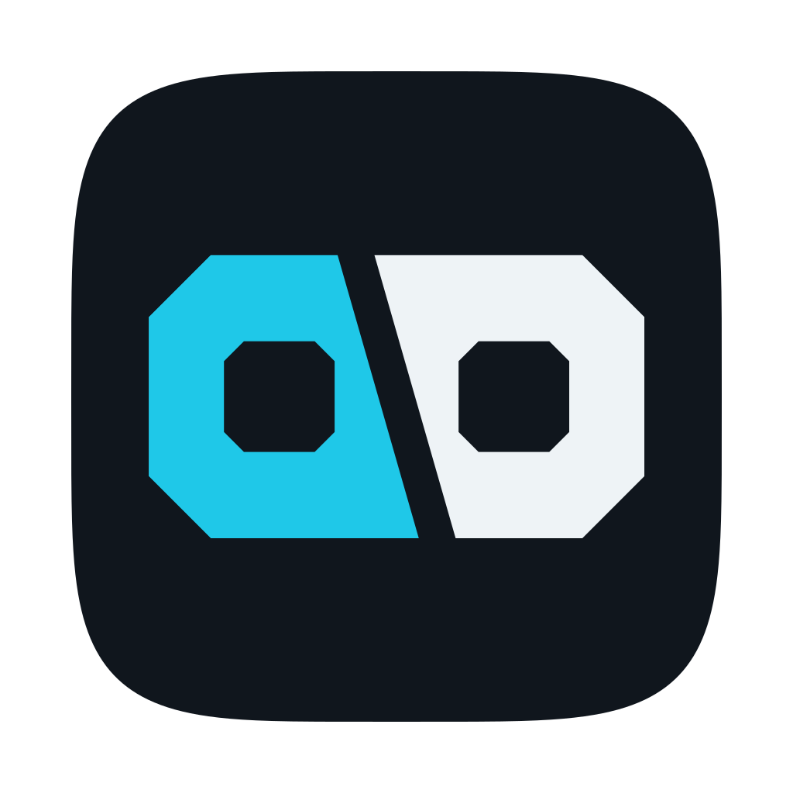
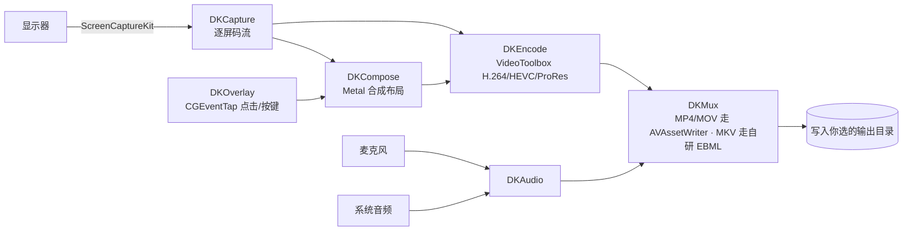

<div align="center">



# Disynk

**macOS 多屏录制 · 截图 · 本地 OCR**

[](https://github.com/Rhinocros/Disynk/actions/workflows/release.yml)
[](https://github.com/Rhinocros/Disynk/releases/latest)
[](#运行环境)
[](#运行环境)
[](#从源码构建)
[](LICENSE)

[English](README.md) · **简体中文**

</div>

---

## 这是什么

Disynk 是为「要录的不只是一块屏」的人做的原生 macOS 应用。它能同时采集多块显示器，并在同一次录制里
额外产出一路**按桌面布局合成**的整体画面——各路独立成片，同时你手里还有一条能说明「它们当时是怎么
摆在一起」的视频。画面、麦克风声音、文字识别全部在本机完成：录制不需要账号，不上传任何内容，产物里
也不含统计 SDK。

应用常驻菜单栏，全局快捷键直接开始/停止录制，不必把它调到前台。主窗口分区为
录制 / 截图·OCR / 快捷键 / 虚拟屏 / 权限 / 关于。

## 功能

| 方面 | 具体能力 |
| --- | --- |
| **录制** | 单屏录制、多屏并发录制、多屏合并输出（按布局合成一路整体画面）；帧率与屏幕选择可配。 |
| **编码** | VideoToolbox 出 H.264 / HEVC (H.265) / ProRes 422。码率按像素数、帧率与编码推算（HEVC 取 H.264 的 0.65 倍）；ProRes 是 CPU 软编路径，多屏同录时界面会显式提示而不是闷头丢帧。 |
| **封装** | MP4 / MOV 走 `AVAssetWriter`；MKV 走自研 EBML 写手（`DKMux`），不依赖外部混流器。 |
| **音频** | 系统音频 + 麦克风同一次录制里混音成 AAC。 |
| **截图** | 全屏 / 单窗口 / 自由区域；滚动长截图自动拼接；OCR 结果可导出 TXT 或 Markdown。 |
| **OCR** | Apple Vision 离线识别，语言 `zh-Hans`、`zh-Hant`、`en-US`；不调用任何在线识别服务。 |
| **GIF / WebM** | 短循环 GIF 导出；装配 libvpx 后可出 WebM（VP8/VP9 软编）。 |
| **覆盖层** | 鼠标点击高亮与按键字符合成进录制画面，事件来自 `CGEventTap`。 |
| **虚拟屏** | 通过私有 `CGVirtualDisplay` 接口创建无头显示器（ObjC 桥接见 `Sources/DVKObjC`）。 |
| **摄像头** | 摄像头画中画合成进采集画面。 |
| **菜单栏** | 常驻状态项与菜单；默认录制开关 `⌘⇧R`，所有动作可在「快捷键」页改绑。 |

## 一条录制是怎么产出的



模块依赖单向、可独立测试；工程取舍的理由见
[docs/ARCHITECTURE.md](docs/ARCHITECTURE.md) 的依赖表与决策记录。

## 运行环境

- **macOS 15（Sequoia）及以上**——部署目标 `x-apple-macos15.0`。macOS 15 恰好也是最后支持 Intel 的
  大版本，所以 Intel 的上限和我们的下限重合。
- **通用二进制**——Release 里的 DMG 同时含 `arm64` 与 `x86_64` 切片：CI 在 Apple Silicon runner 上
  分别编译（`x86_64` 用 macOS SDK 交叉编译）再 `lipo` 合并。
- **Intel 机型**必须能跑 Sequoia，型号范围见
  [Apple 官方兼容列表](https://support.apple.com/en-us/120282)。
- 所需权限：屏幕录制（采集）、麦克风（解说）、辅助功能（点击/快捷键覆盖层与全局快捷键）、
  摄像头（画中画）、Apple 事件（窗口整理，仅 hardened runtime 构建会请求）。
  缺哪项权限就只影响对应功能，不会连带退化其它采集。

> **Intel 支持的现状**：`x86_64` 切片每次发布都会构建并校验存在，但作者没有 Intel 真机可跑。
> 硬件编码器可用性（HEVC/ProRes）、多屏 ScreenCaptureKit 吞吐、私有虚拟屏接口在 Intel 上的行为都可能
> 与 Apple Silicon 不同，因此 Intel 属尽力而为——遇到问题请开 issue。

## 安装与首次运行

1. 从[最新 Release](https://github.com/Rhinocros/Disynk/releases/latest) 下载 `Disynk-<版本>.dmg`，
   把 `Disynk.app` 拖进「应用程序」。
2. 发布产物是 **ad-hoc 签名、未公证**，首次启动会被 Gatekeeper 拦下：
   ```sh
   xattr -cr /Applications/Disynk.app
   ```
   或打开「系统设置 → 隐私与安全性」，点底部的**仍要允许**。
3. 在应用内「权限」页授予屏幕录制（需要时再加麦克风 / 辅助功能），该页会直达对应的隐私面板。
4. 按 `⌘⇧R` 开始录制。

ad-hoc 签名每次重编译 cdhash 都会变，macOS 把每次更新当成新应用：**升级后要重新勾选屏幕录制权限**。
「权限」页给出了 `tccutil` 提示与直达入口。Developer ID + 公证的构建（授权可跨版本保持）由同一套脚本
切换环境变量产出，见 [docs/ARCHITECTURE.md](docs/ARCHITECTURE.md) 第五节。

## 用法要点

**录制**：选屏幕、选编码与容器、设帧率与码率。多屏录制得到各路独立文件；开启合并输出再多得一条整体
布局画面。多屏同录选 ProRes 是 CPU 软编，界面会提示负载而不是偷偷丢帧。

**截图与 OCR**：区域 / 窗口 / 全屏截图写入输出目录；滚动捕获拼长图；OCR 在本机跑完可导出 TXT 或 Markdown。

**覆盖层**：勾选后点击高亮与按键字符直接合成进录制帧，录到什么就是什么，不需要事后再烧一遍。

**虚拟屏**：造一块物理上不存在的显示器，用来铺开大时间线，或把某个应用的窗口单独隔离成一路采集源。
这依赖未公开的 CoreGraphics 接口，风险见「已知限制」。

## 从源码构建

项目**零第三方 Swift 依赖**，只用 Apple 系统框架；WebM 需要一个可选的 libvpx dylib。

```sh
zsh Scripts/build.sh         # 逐模块编译 → .build/<arch>/Disynk
zsh Scripts/test.sh          # 编译并运行 Tests/DKTests 断言用例
zsh Scripts/package.sh       # 编译 → 组装 .app → 签名 → .build/dist/Disynk-<版本>.dmg
zsh Scripts/build_libvpx.sh  # 拉取 libvpx v1.15.2 并编出 WebM 所需 dylib
```

构建开关（默认值都保持「本机单架构、不带 libvpx」的快循环）：

| 变量 | 默认 | 作用 |
| --- | --- | --- |
| `DISYNK_ARCHS` | 本机架构 | 空格分隔的架构列表，逐个编译后 lipo，例如 `arm64 x86_64`。 |
| `DISYNK_MIN_MACOS` | `15.0` | `-target` 三元组里的部署目标。 |
| `DISYNK_WITH_LIBVPX` | dylib 存在时自动开 | `1` 装配 WebM，`0` 显式关闭。 |
| `DISYNK_VERSION` | `Resources/Info.plist` | `package.sh` 写进 bundle 的版本号。 |
| `LIBVPX_VERSION` | `1.15.2` | `build_libvpx.sh` 钉住的上游 tag。 |

架构、部署目标与本机工具链的兼容性修补统一放在
[`Scripts/toolchain.zsh`](Scripts/toolchain.zsh)——一份定义，各脚本 source。

**可选 WebM。** `Scripts/vendor/libvpx/lib/libvpx.11.dylib` 存在时 `package.sh` 自动装配（该 dylib 不入库）。
没有它时 `WebMExporter.codecFactory` 保持 `nil`，选 WebM 产出会在运行时失败，其它功能不受影响。
CI 会从上游源码编 libvpx：逐架构编译、校验每个切片都导出手写 shim 声明的全部符号、把 install-name
改写为 `@rpath/libvpx.11.dylib`，再拷进 `Disynk.app/Contents/Frameworks`。

**测试。** `Tests/DKTests/main.swift` 是轻量断言运行器（不依赖 XCTest，本身是可执行目标），覆盖编码 × 封装矩阵、
MKV 音频、WebM 容器、Metal 合成与合并、设置读写、截图/OCR 导出、像素
计算、滚动拼接、覆盖层组合、采集帧率钳制与权限重授权。`Scripts/test.sh` 还会用第三方解码器
（`Scripts/verify_media.py`，PyAV/ffmpeg）重新打开自研封装产物，确保我们的 EBML 写手能被别人读出来。

## 目录结构

```
Sources/
  DKCore/ DKSettings/                共享类型、几何、设置
  DKEncode/ DKMux/                   VideoToolbox 编码、MP4/MOV/MKV 产出
  DKCapture/ DKCompose/ DKAudio/     ScreenCaptureKit 采集、Metal 合成、音频
  DKShot/ DKOverlay/ DKExport/       截图与 OCR、事件覆盖层、GIF/WebM 导出
  DKVirtualDisplay/ DVKObjC/         私有 CGVirtualDisplay 桥接
  DisynkApp/                         AppKit/SwiftUI 外壳、菜单栏、主窗口
Resources/                           Info.plist（版本事实源）、图标、entitlements
Scripts/                             toolchain.zsh、build、test、package、make_icon、
                                   build_libvpx、verify_media、publish-github、vendor/libvpx
Tests/                               断言式测试入口（XCTest 目标为占位）
docs/ARCHITECTURE.md                 模块拓扑、技术栈表、工程决策
.github/workflows/release.yml        标签触发的构建与发布
logo/                                应用图标、菜单栏图标与矢量素材
```

## 已知限制

- **虚拟屏**依赖未公开的 `CGVirtualDisplay` 接口。macOS 大版本更新可能让它失效，应用内说明对因此丢失的
  录制内容免责。
- **ad-hoc 签名**带来每次更新重授屏幕录制权限、首启被 Gatekeeper 拦截两笔代价。公证构建需要 Developer ID
  证书，只有维护者能提供。
- **Intel 构建有产物但未经 Intel 真机验证**（见「运行环境」）。
- 画面与音频完全不离开本机，因此也就没有云端同步预设/录制这类能力。
- 采集链假设有一个真实的 GPU/WindowServer 会话。无显示器的 headless 或远程桌面会话可能一帧都不出——
  请接上显示器，或用虚拟屏造一块。

## 隐私

屏幕内容、麦克风录音、摄像头画面与文字识别全部在本机处理；OCR 使用 Apple Vision，不调用任何在线识别
服务。Disynk 不收集使用数据、不投放广告、不含第三方统计或埋点 SDK，而且完全不联网：没有激活校验、
不回访任何服务器、不做更新探测。诊断日志写入系统「控制台」的应用日志，只含功能状态与错误描述，
状态与错误描述，不含屏幕像素内容。

## 许可

Disynk 是自由软件：本仓库源码以 **GNU 通用公共许可证第 3 版或其后任一版本**（GPL-3.0-or-later）发布，
许可证原文见 [LICENSE](LICENSE)。

在其之上，[ADDITIONAL-TERMS.md](ADDITIONAL-TERMS.md) 依据 GPL-3.0 **第七条 (b)(c)** 附加了以下条款：

- 再分发 Disynk（无论是否修改）必须保留项目源地址 <https://github.com/Rhinocros/Disynk>、
  一句来源标注，以及 `LICENSE`、`ADDITIONAL-TERMS.md`、`THIRD-PARTY-NOTICES.md` 的完整文本。
- 衍生版本的应用界面必须保留**至少一处指向该源地址的可点击链接**（Disynk 自己放在「关于」页）；
  可以改样式换位置，但不许移除，也不许降级成点不动的纯文本。
- 对外提供的版本必须继续开源：衍生作品整体沿用 GPL-3.0-or-later 并随附完整对应源码，不可闭源分发。

2026-10 之前的版本附带与授权激活绑定的专有许可声明。该机制（激活码、硬件指纹绑定、功能门控）已从
代码树中整体移除，旧的专有条款不再适用于当前源码及其衍生版本。

第三方组件见 [THIRD-PARTY-NOTICES.md](THIRD-PARTY-NOTICES.md)——特别是 libvpx（BSD-3-Clause），
其许可原文由 CI 附在每个 Release 上。

## 发布与 CI

推送 `vX.Y.Z` 标签即触发 [`.github/workflows/release.yml`](.github/workflows/release.yml)：先编 libvpx，
再为 `arm64` **和** `x86_64` 分别编译全部模块、`lipo` 成单个可执行、组装并 ad-hoc 签名 `.app`、生成 DMG，
最后发布到 GitHub Releases（另有 `workflow_dispatch` 入口可手动跑）。移动已有标签会重跑并覆盖同名产物。

公开仓库只承载发布快照——见 [`Scripts/publish-github.sh`](Scripts/publish-github.sh)。
开发历史与演示站点留在维护者自己的远端，有意不公开。

## 相关

- [English README](README.md)
- [架构说明](docs/ARCHITECTURE.md)
- [图标与素材](logo/README.md)
- [发布记录](https://github.com/Rhinocros/Disynk/releases) · [Issues](https://github.com/Rhinocros/Disynk/issues)
